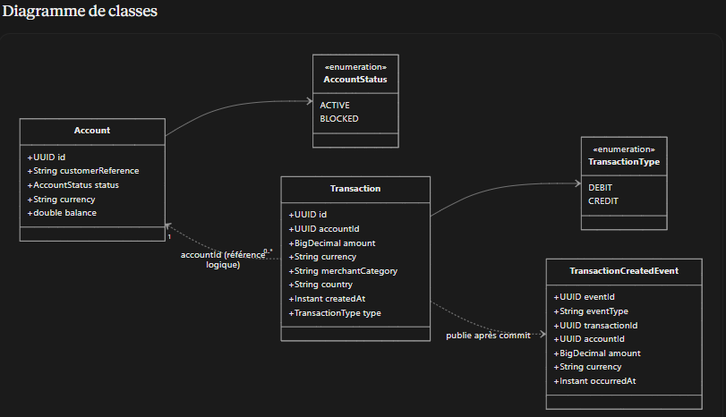
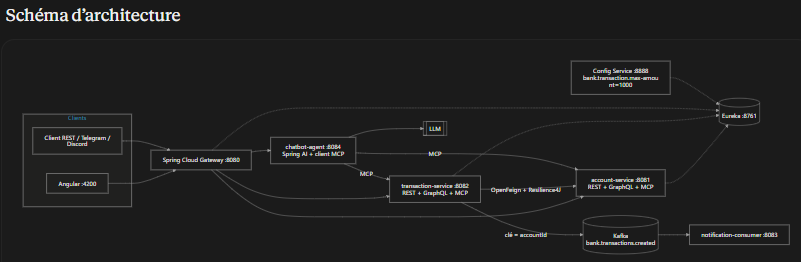
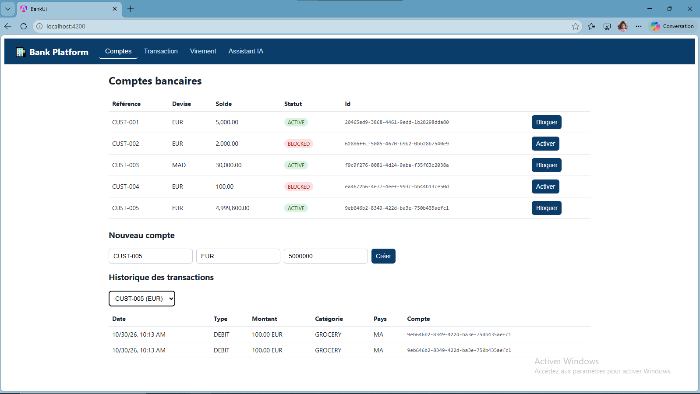
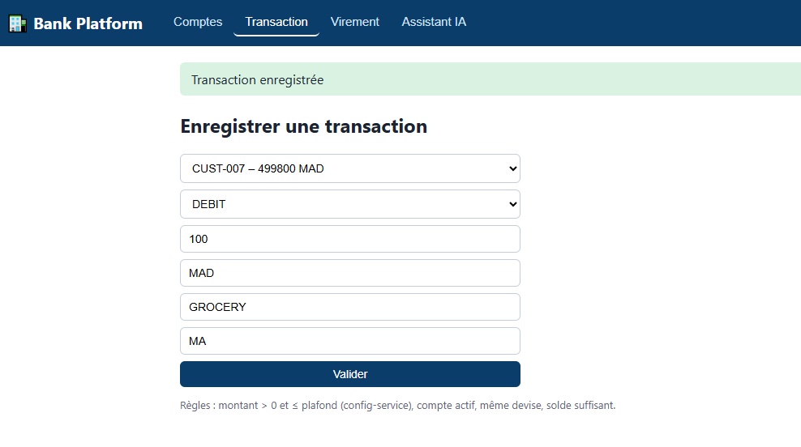
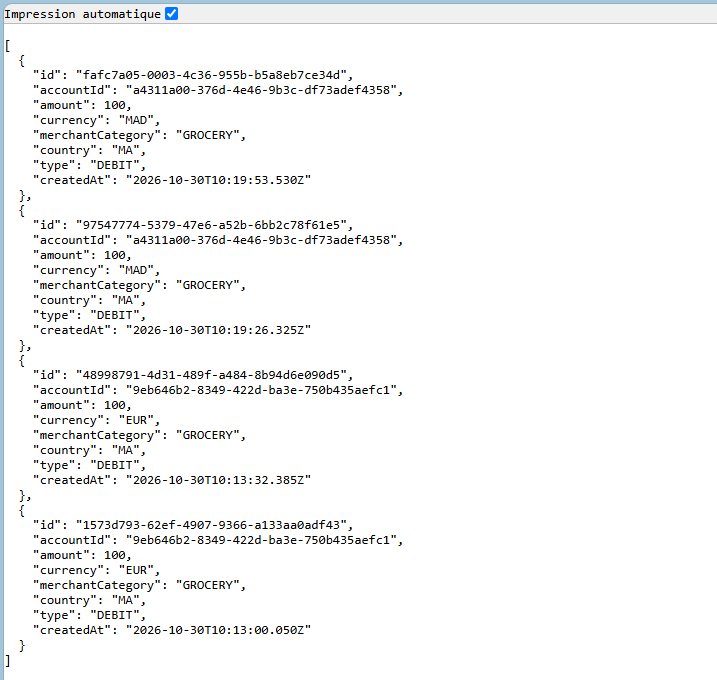
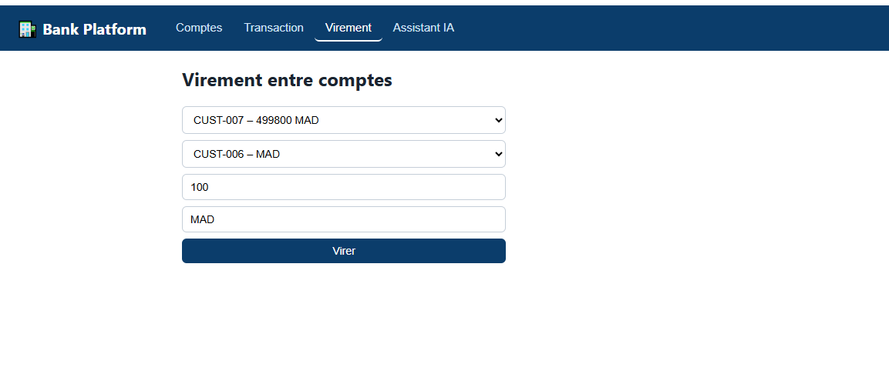
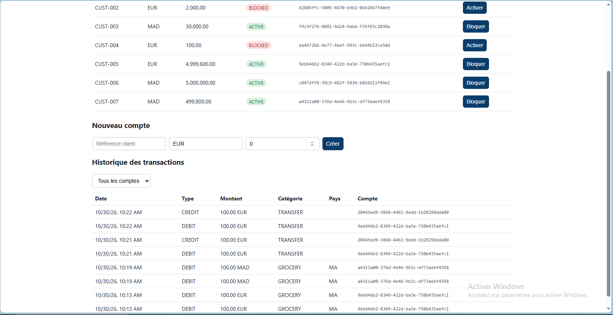
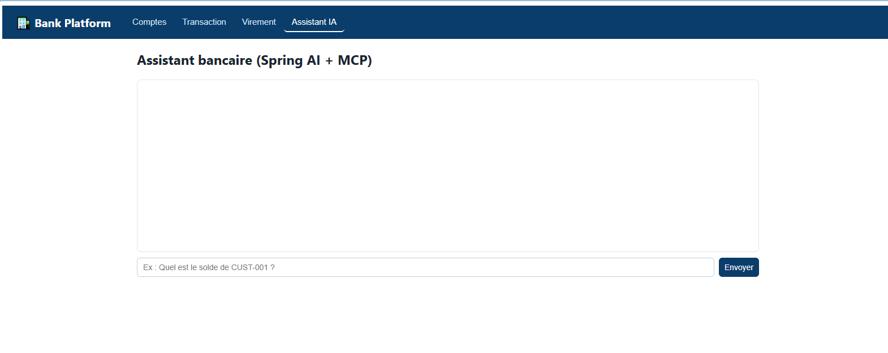
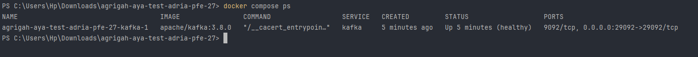

# agrigah-aya-test-adria-pfe-27 — Plateforme bancaire micro-services

Épreuve technique ADRIA PFE 27 — candidate : **Agrigah Aya**.
Rapport PDF (réponses + captures d'écran) : [`docs/RAPPORT.pdf`](docs/RAPPORT.pdf) · Architecture : [`docs/architecture.md`](docs/architecture.md) · DevOps : [`docs/DEVOPS.md`](docs/DEVOPS.md)

Fonctionnalités : consultation des comptes, transactions (plafond, devise, compte actif, solde), virements, événements Kafka,
assistant IA (Spring AI + MCP), client Angular, détection de fraude (Python), Docker / GitHub Actions.

| Module | Port | Rôle |
|---|---|---|
| discovery-service | 8761 | Eureka |
| config-service | 8888 | Config centralisée (`bank.transaction.max-amount=1000`) |
| account-service | 8081 | Comptes : REST + GraphQL + MCP |
| transaction-service | 8082 | Transactions/virements : REST + GraphQL + MCP, Feign + Resilience4J, producer Kafka |
| notification-consumer | 8083 | Consumer Kafka (journalisation) |
| chatbot-agent | 8084 | Agent Spring AI + outils MCP |
| gateway-service | 8080 | Point d'entrée |
| bank-ui | 4200 | Client Angular |
| fraud-detection | — | Notebook Python |

Prérequis : JDK 21, Maven 3.9+, Docker, Node 20+ (Angular), Python 3.10+.

## Conception (Partie B)

### Diagramme de classes


### Schéma d'architecture


## Interface Angular et captures (Partie G)

Client web `bank-ui` (http://localhost:4200) : onglets **Comptes**, **Transaction**, **Virement** et **Assistant IA**.

### Comptes bancaires
Liste des comptes (référence, devise, solde, statut), blocage / activation, création d'un compte, historique des transactions.



### Enregistrer une transaction
Règles appliquées : montant > 0 et ≤ plafond (config-service), compte actif, même devise, solde suffisant.



### Réponse REST des transactions
`GET /api/transactions` : `id`, `accountId`, `amount`, `currency`, `merchantCategory`, `country`, `type`, `createdAt`.



### Virement entre comptes


### Historique après virement
Un virement crée deux écritures `TRANSFER` : `DEBIT` sur le compte source, `CREDIT` sur le compte destination.



### Assistant IA (Spring AI + MCP)


### Kafka avec Docker



## Option 1 — Tout avec Docker (le plus simple)
```bash
cp .env.example .env          # y mettre la clé du LLM
docker compose up --build     # 1er build ≈ 5-10 min
docker compose ps             # tout doit être "healthy"
```
## Option 2 — En local (développement)
```bash
mvn clean install -DskipTests
docker compose up -d kafka                       # Kafka seul (localhost:29092)
export OPENAI_API_KEY=...                        # Windows PowerShell : $env:OPENAI_API_KEY="..."
# un terminal par service, DANS CET ORDRE :
mvn -pl discovery-service spring-boot:run
mvn -pl config-service spring-boot:run
mvn -pl account-service spring-boot:run
mvn -pl transaction-service spring-boot:run
mvn -pl notification-consumer spring-boot:run
mvn -pl chatbot-agent spring-boot:run
mvn -pl gateway-service spring-boot:run
```
Angular : `cd bank-ui && npm install && npm start` → http://localhost:4200
Fraude : `cd fraud-detection && pip install -r requirements.txt` → placer `bank_transactions.csv` → `jupyter notebook fraud_detection.ipynb`

## LLM (partie E)
Tout fournisseur compatible OpenAI (function calling requis) :
- OpenAI : `OPENAI_API_KEY=sk-...` (modèle `gpt-4o-mini`)
- Groq (gratuit) : `OPENAI_BASE_URL=https://api.groq.com/openai`, `OPENAI_MODEL=llama-3.3-70b-versatile`
- Ollama (local) : `OPENAI_BASE_URL=http://localhost:11434`, `OPENAI_MODEL=llama3.1`, clé quelconque

## Scénarios de test (via la gateway)
```bash
curl http://localhost:8080/api/accounts                       # noter 2 ids EUR actifs : A et B
curl -X POST http://localhost:8080/api/transactions -H 'Content-Type: application/json' \
  -d '{"accountId":"<A>","amount":250,"currency":"EUR","merchantCategory":"GROCERY","country":"MA","type":"DEBIT"}'   # 201
curl -X POST http://localhost:8080/api/transactions -H 'Content-Type: application/json' \
  -d '{"accountId":"<A>","amount":5000,"currency":"EUR"}'     # 422 plafond 1000
curl -X POST http://localhost:8080/api/transactions -H 'Content-Type: application/json' \
  -d '{"accountId":"<A>","amount":10,"currency":"USD"}'       # 422 devise
curl -X POST http://localhost:8080/api/transactions -H 'Content-Type: application/json' \
  -d '{"accountId":"<ID CUST-004 BLOQUE>","amount":10,"currency":"EUR"}'   # 422 compte bloqué
curl -X POST http://localhost:8080/api/transfers -H 'Content-Type: application/json' \
  -d '{"fromAccountId":"<A>","toAccountId":"<B>","amount":100,"currency":"EUR"}'
curl -X POST http://localhost:8080/api/chat -H 'Content-Type: application/json' \
  -d '{"message":"Quel est le solde du compte CUST-001 ?"}'
```
GraphQL (http://localhost:8081/account-graphiql, http://localhost:8082/transaction-graphiql) :
```graphql
{ accounts { id customerReference balance status } }
mutation { createTransaction(input:{accountId:"<A>", amount:50, currency:"EUR", merchantCategory:"FUEL", country:"MA"}) { id amount type } }
```
Résilience : arrêter account-service puis rappeler `POST /api/transactions` → `503` (fallback) ; après quelques échecs
`http://localhost:8082/actuator/health` montre le circuit breaker `OPEN`. Relancer account-service : retour à la normale après 10 s.

Kafka : le log de notification-consumer affiche `[EVENT RECEIVED] ...` après chaque transaction.
Eureka : http://localhost:8761 — Swagger : http://localhost:8081/swagger-ui.html et http://localhost:8082/swagger-ui.html

## Structure du dépôt
```
account-service/  transaction-service/   micro-services métier (domain, repository, service, web/rest, web/graphql, mcp)
discovery-service/ config-service/ gateway-service/   composants techniques Spring Cloud
notification-consumer/                   consumer Kafka (journalisation)
chatbot-agent/                           agent Spring AI + client MCP
bank-ui/                                 client Angular
fraud-detection/                         notebook + scripts Python
docs/                                    rapport PDF, diagrammes, captures
Dockerfile, docker-compose.yml, .github/workflows/ci-cd.yml
```

## Limites connues
- Keycloak (cité dans l'architecture cible) non implémenté.
- Le notebook de fraude a été exécuté sur un jeu synthétique ; relancer avec `bank_transactions.csv` pour les résultats officiels.
- Le chatbot nécessite une clé LLM valide (voir section « LLM »).
- H2 en mémoire pour la simplicité ; PostgreSQL recommandé en production.
