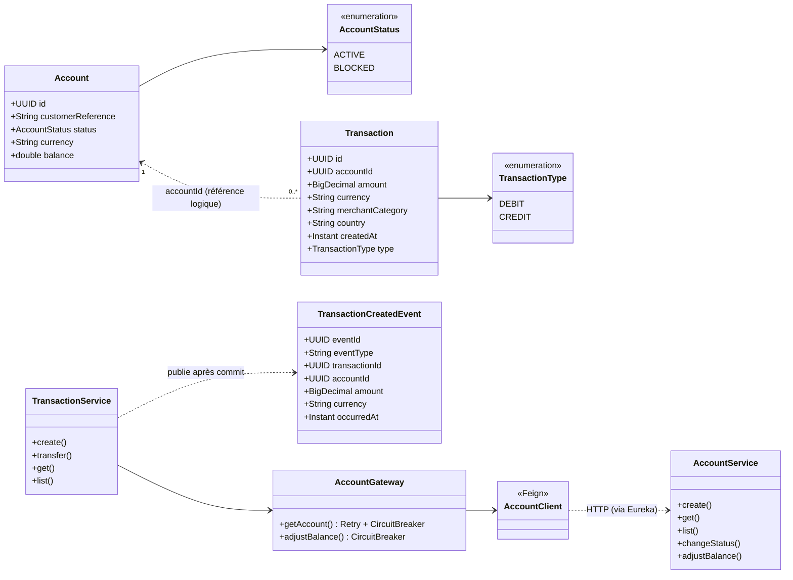
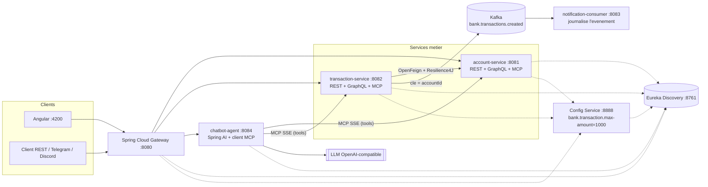
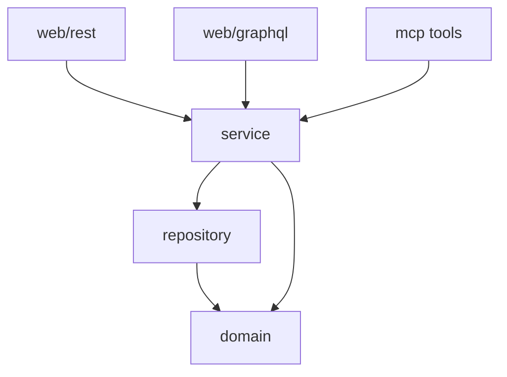
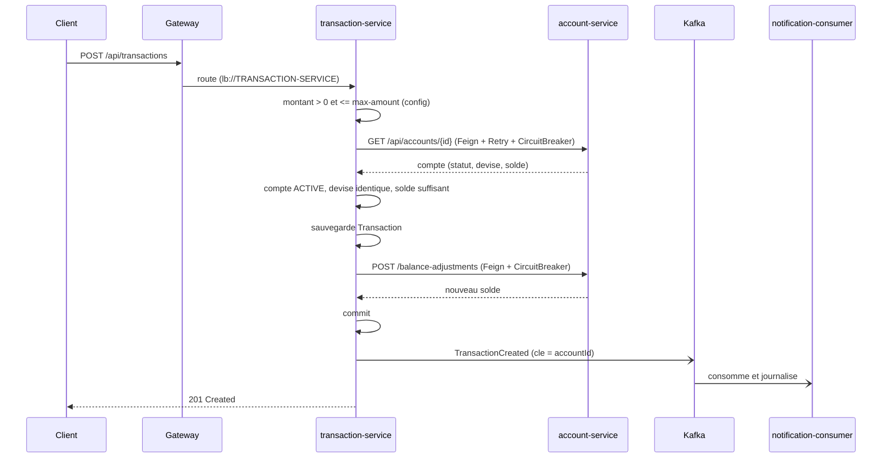

# Partie B — Conception et architecture (Mermaid)

## Diagramme de classes

## Schéma d'architecture

## Séparation des couches (par micro-service métier)

## Séquence : création d'une transaction

